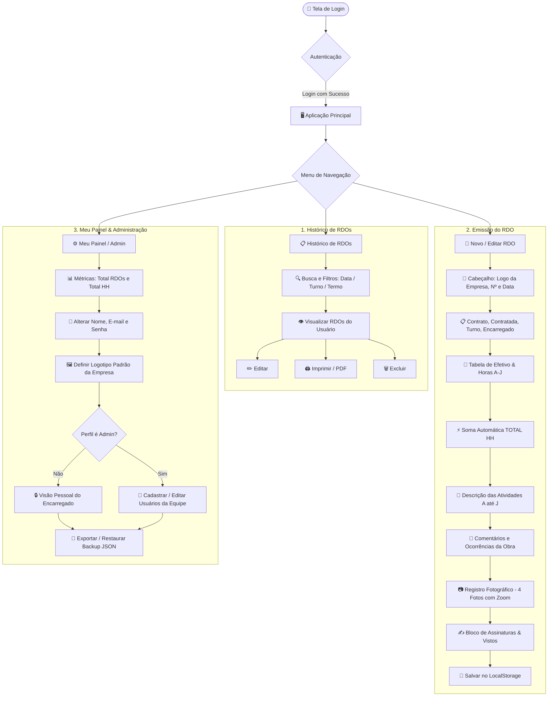

# 📘 Manual de Uso do Sistema RDO - Engenharia CMPC
### *Sistema de Gestão da Qualidade - Relatório Diário de Obra*

---

## 🗺️ 1. Mapa Visual da Aplicação

---

## 🏗️ 2. Arquitetura do RDO (Fidelidade ao Padrão CMPC)

```mermaid
graph TD
    subgraph RDO_Document [Estrutura do Relatório Diário de Obra]
        A["1. LOGO DA EMPRESA + Título SGQ ENGENHARIA CMPC"]
        B["2. NÚMERO (0000/ANO) + DATA DO DIA"]
        C["3. CONTRATO N.º | CONTRATANTE | CONTRATADA | EQUIPE | DIA SEMANA | TURNO"]
        D["4. EFETIVO: MATRÍCULA | FUNÇÃO | NOME | HORAS NAS ATIVIDADES (A a J)"]
        E["5. TOTAL HH (Cálculo Automático)"]
        F["6. DESCRIÇÃO DAS ATIVIDADES (A a J) + VISTO DO ENCARREGADO"]
        G["7. COMENTÁRIOS / CLIMA / DDS / OBSERVAÇÕES"]
        H["8. REGISTRO FOTOGRÁFICO (4 Imagens Pequenas com Zoom Lightbox)"]
        I["9. ASSINATURAS: PLANEJAMENTO | ENG. DE PRODUÇÃO | FISCALIZAÇÃO CMPC"]
    end
    A --> B --> C --> D --> E --> F --> G --> H --> I
```

---

## 👥 3. Perfis de Acesso e Isolamento de Dados

O sistema conta com **segurança e isolamento completo por usuário**:

| Perfil | Acesso a RDOs | Logotipo da Empresa | Gestão de Equipe |
| :--- | :--- | :--- | :--- |
| **Administrador** (`Admin`) | Visualiza **todos** os RDOs de todas as equipes | Configura seu logotipo padrão | **Sim** (Cria, edita e exclui logins de usuários) |
| **Encarregado de Obra** | Visualiza e edita **apenas os seus próprios RDOs** | Configura seu logotipo padrão | **Não** (Acessa somente seu painel pessoal) |
| **Engenheiro / Fiscal** | Visualiza e assina **seus RDOs atribuídos** | Configura seu logotipo padrão | **Não** (Acessa somente seu painel pessoal) |

---

## 🚀 4. Passo a Passo de Utilização

### Passo 1: Acesso ao Sistema (Login)
1. Abra o arquivo `index.html` em qualquer navegador (Chrome, Edge, Firefox, Safari ou navegador do celular).
2. Utilize as credenciais do **Administrador Master** para primeiro acesso:
   - **Administrador Master:** `engelmobile2020@gmail.com` | Senha: `789512`
3. Como Administrador Master, você pode acessar a aba **`Painel Admin`** para criar e liberar os perfis dos encarregados e membros da equipe.

---

### Passo 2: Configurar o Logotipo da sua Empresa
1. Acesse a aba **`Meu Painel`** (ou **`Painel Admin`**) e localize o card **`Logotipo Padrão da Minha Empresa`**.
2. Clique no campo de seleção ou no botão **`Enviar Novo Logotipo`** e escolha a imagem da sua empresa.
3. O logotipo será salvo no seu perfil e **carregado automaticamente no cabeçalho de todos os novos RDOs que você criar**.

---

### Passo 3: Preencher e Emitir um Novo RDO
1. Clique no menu **`Novo RDO`**.
2. **Dados Iniciais:**
   - O número sequencial (ex: `0001/2026`) é sugerido automaticamente.
   - Ao selecionar a **Data**, o campo **Dia da Semana** é preenchido automaticamente.
   - Selecione o **Turno** (`Diurno` ou `Noturno`).
   - Preencha o **Nº do Contrato**, **Contratante** e **Contratada**.
3. **Efetivo e Horas:**
   - Adicione colaboradores clicando em **`+ Adicionar Colaborador`**.
   - Digite a `Matrícula`, `Função` e `Nome`.
   - Lance as horas de trabalho sob as letras das atividades realizadas (`A`, `B`, `C`, etc.).
   - O campo **TOTAL HH** é calculado **em tempo real de forma automática**.
4. **Descrição das Atividades:**
   - Descreva o serviço correspondente a cada letra utilizada (`A` até `J`).
   - Lance o visto/rubrica do encarregado responsável.
5. **Comentários:**
   - Descreva as condições de tempo, DDS ministrado, ocorrências ou atrasos.
6. **Registro Fotográfico:**
   - Clique em qualquer um dos **4 slots de foto** para carregar imagens da obra.
   - Digite a legenda da foto no campo abaixo dela.
   - **Visualização Ampliada:** Clique sobre qualquer foto carregada para abri-la em **tela cheia (*Lightbox*)**.
7. **Assinaturas:**
   - Preencha os campos de assinatura do `Planejamento`, `Engenheiro de Produção` e `Fiscalização CMPC`.
8. Clique no botão **`Salvar RDO`**.

---

### Passo 4: Impressão e Geração de PDF Oficial
1. Na listagem de RDOs ou dentro do editor, clique em **`Imprimir / PDF`**.
2. A folha oficial formatada para **A4 retrato** será gerada sem menus, botões ou barras de navegação, idêntica ao modelo físico da CMPC.
3. **Divisão de Páginas e Cabeçalho Repetido:** Em documentos com mais de uma página, o cabeçalho oficial (Logo da Empresa, Título SGQ CMPC, Nº, Data, Contrato e Turno) é **automaticamente repetido no topo de cada página subsequente**, mantendo a identidade e o padrão formal de documentação técnica.
4. Escolha a impressora física ou selecione **"Salvar como PDF"**.

---

### Passo 5: Gerenciamento no "Meu Painel"
1. Clique na aba **`Meu Painel`** (ou `Painel Admin`):
   - **Métricas:** Visualize o total de RDOs emitidos por você e o total de horas apropriadas.
   - **Meus Dados:** Altere seu nome, e-mail e senha a qualquer momento.
   - **Logotipo:** Atualize ou remova a imagem padrão da sua empresa.
   - **Gestão de Equipe (Admin):** Crie novos acessos para encarregados da sua equipe.
   - **Backup:** Exporte uma cópia completa dos dados em arquivo `.json` ou restaure backups anteriores.

---

### Passo 6: Segurança & Exclusão Protegida por Senha
- Para garantir integridade máxima e evitar apagamentos acidentais de dados de obras e auditorias, a exclusão de **qualquer RDO**, **usuário da equipe** ou **logotipo** abre um **modal moderno e centralizado de confirmação**.
- **Senha Global de Exclusão:** `123456` *(obrigatória para todos os perfis de usuário)*.
- O sistema somente efetiva a remoção caso a senha digitada seja exatamente `123456`.

---

### Passo 7: Bloqueio Automático após 24 Horas
- RDOs criados há mais de **24 horas** recebem automaticamente o selo **`🔒 Bloqueado (+24h)`**.
- Ao visualizar ou imprimir um relatório emitido há mais de 24 horas, uma **tarja transparente** atravessando diagonalmente a folha é exibida com os dizeres: **`BLOQUEADO APÓS 24hrs`**.
- O bloqueio garante a conformidade com as normas do SGQ e a rastreabilidade técnica dos relatórios da obra.

---

## 💡 Dicas e Boas Práticas
- **Senha de Exclusão (Todos os Perfis):** `123456`
- **Banco na Nuvem (Google Firebase Firestore):** Os dados e relatórios são salvos e sincronizados automaticamente na nuvem Firebase do projeto `rdocmpc`, permitindo acesso instantâneo de qualquer dispositivo conectado.
- **Funcionamento Offline & Cache:** Caso a obra fique temporariamente sem internet, o sistema continua funcionando normalmente gravando no cache local (`localStorage`) e sincroniza com a nuvem assim que a conexão retornar.
- **Uso no Celular:** O sistema é 100% responsivo. No canteiro de obras, você pode tirar fotos diretamente da câmera do celular nos slots de imagem.
- **Backups:** Você também pode exportar cópias manuais de segurança pelo botão **Exportar Backup (JSON)**.
- **Teclado:** Pressione **`ESC`** a qualquer momento para fechar o visualizador de fotos em tela cheia ou qualquer janela modal.

---

## 👥 Créditos & Desenvolvimento
- **💡 Idealizador:** Vitor Schneider Abrahão (`vitor.abrahao@cmpc.com`)
- **💻 Desenvolvedor:** Luciano Engel (`sistemasengenharia@cmpcrs.com.br`)
- **🏢 Institucional:** Sistema de Gestão da Qualidade - Engenharia CMPC
